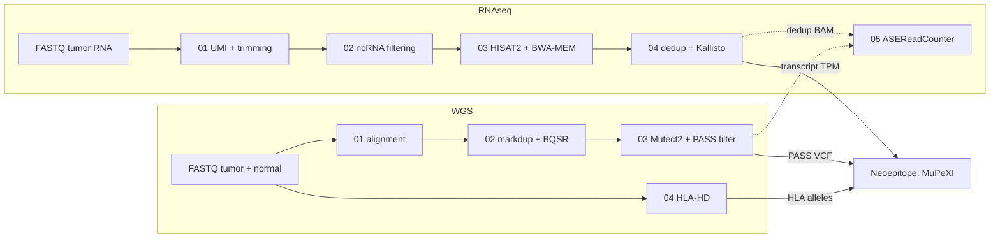

# Neoepitope Prediction Pipeline

A bioinformatics workflow for the identification of tumor-specific neoepitopes using whole-genome sequencing (WGS) and RNA sequencing (RNA-seq) data.

## 1. Overview

Neoepitopes are tumor-specific peptides derived from somatic alterations that can be presented by human leukocyte antigen (HLA) molecules and potentially recognized by T cells. Their identification is a necessary step in the development of personalized cancer immunotherapies, including therapeutic cancer vaccines.

This repository contains bioinformatics scripts used to identify, characterize, and prioritize candidate neoepitopes by integrating genomic and transcriptomic datasets.

This workflow combines:

- Whole-genome sequencing (WGS): Identification of somatic variants by comparing tumor and matched normal DNA.
- RNA sequencing (RNA-seq): Assessment of gene-level and transcript-level expression supporting candidate neoepitopes.
- HLA typing: Identification of patient-specific HLA alleles occurs on both DNA and RNA level.
- Neoepitope prediction: Generation of all possible mutant peptides arising from patient-specific somatic variants and prediction of their binding to patient-specific HLA molecules.

## 2. Sequencing Data and Library Preparation

The workflow is primarily designed for paired-end sequencing data generated from tumor tissue and matched normal samples.

### 2.1 Whole-Genome Sequencing

Whole-genome sequencing should be performed on DNA extracted from tumor samples and matched normal material, such as peripheral blood.

The workflow is designed for Illumina paired-end short-read WGS data, such as libraries generated using the KAPA EvoPlus library preparation workflow.

Tumor and matched normal sequencing data are analyzed together to distinguish somatic alterations from inherited genetic variation.

### 2.2 RNA Sequencing

RNA sequencing is used to investigate transcriptional activity in tumor samples and determine whether genes carrying somatic variants are expressed.

The RNA-seq workflow scripts are designed for libraries generated using the SMARTer Stranded Total RNA-Seq Kit v3 – Pico Input Mammalian, developed for low-input RNA samples. If other library preparation kits are used, the UMI-based deduplication strategy should be adjusted accordingly

## 3. Bioinformatics Workflow

Steps marked *(planned)* are described for completeness but are not yet implemented in this repository.

### 3.1 WGS Processing (`WGS/`)

The WGS analysis starts with raw paired-end FASTQ files from tumor and matched normal samples.

1. Quality control (`QC/01_fastqc`): FastQC on the raw reads.
2. Read alignment (`01_alignment`): mapping of reads to GRCh38 with BWA-MEM, followed by coordinate sorting.
3. Alignment processing (`02_preprocessing`): duplicate marking (biobambam2) and base quality score recalibration (GATK BQSR).
4. Somatic variant calling (`03_variant_calling`): tumor–normal calling with GATK Mutect2.
5. Variant filtering (`03_variant_calling`): GATK FilterMutectCalls and retention of PASS variants.
6. Variant annotation (`03_variant_calling`): Ensembl VEP 113.
7. HLA typing (`04_HLA_typing`): HLA-HD on the WGS reads.

The primary output is a set of filtered somatic variants and the patient HLA genotype.

### 3.2 RNA-seq Processing (`RNAseq/`)

1. Quality control (`QC/01_fastqc`): FastQC on the raw reads.
2. UMI extraction and adapter trimming (`01_preprocessing`): UMI-tools and Cutadapt.
3. RNA contamination filtering (`02_rna_filtering`): sequential removal of rRNA, tRNA and sn/snoRNA reads with HISAT2.
4. Read alignment (`03_alignment`): two-step mapping with HISAT2, followed by BWA-MEM for pairs HISAT2 could not align.
5. UMI-aware duplicate removal (`04_expression`): UMI-tools dedup.
6. Expression quantification (`04_expression`): Kallisto, summarised to gene level with tximport.
7. Allele-specific expression (`05_allele_specific_expression`): GATK ASEReadCounter at somatic variant positions.

### 3.3 HLA Typing

- Implemented: HLA-HD on WGS data (`WGS/04_HLA_typing`).
- *(planned)*: HLA-LA on WGS data and seq2HLA on RNA-seq data.

The resulting HLA genotype is used as input for peptide–HLA binding prediction.

### 3.4 Neoepitope Prediction (`Neoepitope/01_prediction`)

- MuPeXI translates somatic variants into mutant peptides, integrates expression and predicts MHC class I binding with netMHCpan (MuPeXI runs VEP and netMHCpan itself).
- `netmhcpan.sh` runs netMHCpan stand-alone on any peptide FASTA.
- MHC class II prediction with netMHCIIpan *(planned)*.

### 3.5 Neoepitope Prioritization *(planned)*

Candidate neoepitopes can be prioritized by integrating predicted binding (percentile rank), expression of the corresponding transcript, variant allele frequency, tumor purity and clonality, and potential HLA loss.

### 3.6 Data Flow Between Modules



| From | Output | Used by |
|------|--------|---------|
| `WGS/03_variant_calling` | PASS-filtered somatic VCF | MuPeXI (`Neoepitope/01_prediction`), ASEReadCounter (`RNAseq/05`) |
| `WGS/04_HLA_typing` | HLA-HD result (`<sample>/result/<sample>_final.result.txt`) | copied manually into an HLA allele file for MuPeXI / netMHCpan |
| `RNAseq/04_expression` | Kallisto `abundance.tsv` (transcript level) | MuPeXI expression input |
| `RNAseq/04_expression` | deduplicated RNA BAM | ASEReadCounter (`RNAseq/05`) |

## 4. Repository Structure

Each module folder contains one or more analysis scripts (`*.sh`, `*.R`), a PBS submission wrapper per script (`submit_*.pbs`) and a `README.md` describing inputs, outputs, software versions and resources.

```text
Neoepitope-prediction-pipeline/
├── README.md
├── LICENSE
├── CITATION.cff
├── run_pipeline.sh                    submits all steps for one patient with PBS dependencies
├── config/
│   └── config.sh                      template with sample and reference paths
├── environment/
│   └── software_versions.tsv          module version used by every step
├── QC/
│   └── 01_fastqc/                     FastQC on raw reads
├── WGS/
│   ├── 01_alignment/                  BWA-MEM alignment and sorting
│   ├── 02_preprocessing/              duplicate marking and BQSR
│   ├── 03_variant_calling/            Mutect2, filtering, VEP annotation
│   └── 04_HLA_typing/                 HLA-HD
├── RNAseq/
│   ├── 01_preprocessing/              UMI extraction and adapter trimming
│   ├── 02_rna_filtering/              rRNA / tRNA / snoRNA removal
│   ├── 03_alignment/                  HISAT2 + BWA-MEM two-step alignment
│   ├── 04_expression/                 UMI deduplication and Kallisto quantification
│   └── 05_allele_specific_expression/ GATK ASEReadCounter
├── Neoepitope/
│   └── 01_prediction/                 MuPeXI and netMHCpan
└── .github/workflows/shellcheck.yml   automatic shellcheck of all scripts
```

## 5. Running the Pipeline

Every step can be submitted on its own; each module README shows the `qsub` command. To submit all steps for one patient at once:

```bash
cd /path/to/Neoepitope-prediction-pipeline
cp config/config.sh config/patient01.sh        # patient copies are not tracked by git
nano config/patient01.sh                        # replace every CHANGE_ME
bash run_pipeline.sh config/patient01.sh --dry-run   # print the qsub commands only
bash run_pipeline.sh config/patient01.sh             # submit
```

Jobs are chained with `qsub -W depend=afterok:...`, so a step only starts when the steps it needs have finished successfully. Logs, the repository commit and a copy of the configuration are written to `<OUT_DIR>/logs/`.

Neoepitope prediction needs the HLA alleles, which are only known after HLA-HD has run. On the first run leave `HLA_FILE` empty; afterwards fill in the allele file (see `Neoepitope/01_prediction/hla_alleles.example.txt`) and run `bash run_pipeline.sh config/patient01.sh --only-prediction`.

Allele-specific expression (`RNAseq/05`) is not part of `run_pipeline.sh` because it needs a VCF prepared for the RNA BAM; submit it separately.

## 6. Computational Environment

The scripts are written for a Linux HPC cluster with PBS/Torque job scheduling and Lmod/EasyBuild software modules (developed on the UGent VSC Tier-2 clusters). The module loaded for every step is listed in [`environment/software_versions.tsv`](environment/software_versions.tsv). To run elsewhere, install the same versions (for example with Conda/Bioconda) and adapt the `module load` lines in the `submit_*.pbs` wrappers.

To cite this pipeline, use the metadata in [`CITATION.cff`](CITATION.cff).

## 7. References and Software

- [BWA](https://github.com/lh3/bwa) — short-read alignment.
- [SAMtools](https://www.htslib.org/) — alignment file processing.
- [biobambam2](https://gitlab.com/german.tischler/biobambam2) — duplicate marking.
- [GATK](https://gatk.broadinstitute.org/) — BQSR, somatic variant calling, ASEReadCounter.
- [Ensembl VEP](https://www.ensembl.org/info/docs/tools/vep/index.html) — variant annotation.
- [HLA-HD](https://www.genome.med.kyoto-u.ac.jp/HLA-HD/) — HLA typing.
- [FastQC](https://www.bioinformatics.babraham.ac.uk/projects/fastqc/) — read quality control.
- [UMI-tools](https://github.com/CGATOxford/UMI-tools) — UMI extraction and deduplication.
- [Cutadapt](https://cutadapt.readthedocs.io/) — adapter trimming.
- [HISAT2](https://daehwankimlab.github.io/hisat2/) — RNA-seq alignment and ncRNA filtering.
- [Kallisto](https://pachterlab.github.io/kallisto/) and [tximport](https://bioconductor.org/packages/tximport/) — expression quantification.
- [MuPeXI](https://github.com/ambj/MuPeXI) — mutant peptide extraction and prioritization.
- [netMHCpan](https://services.healthtech.dtu.dk/) — peptide–MHC class I binding prediction.
- *(planned)* [HLA-LA](https://github.com/DiltheyLab/HLA-LA), [seq2HLA](https://github.com/TRON-Bioinformatics/seq2HLA), netMHCIIpan.

## 8. Disclaimer

This repository is intended for research purposes only. Predicted neoepitopes require appropriate experimental validation before any clinical interpretation or application.
